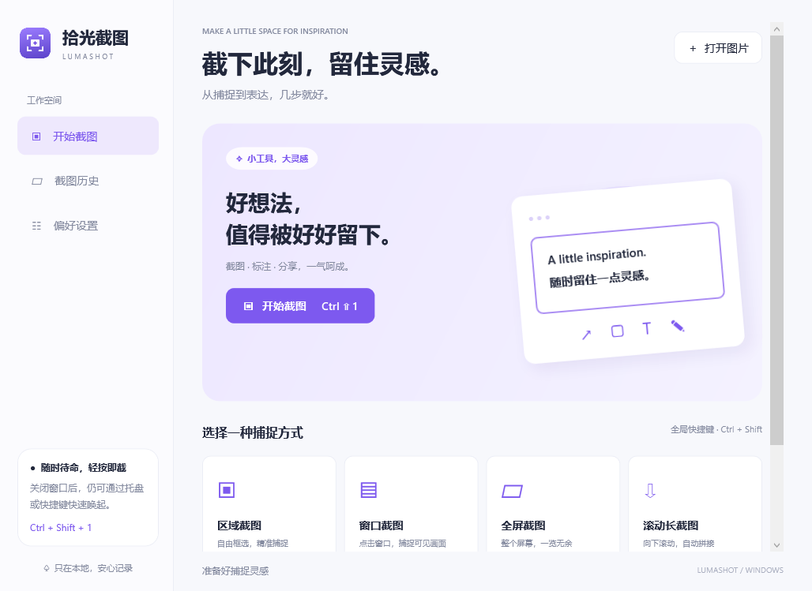
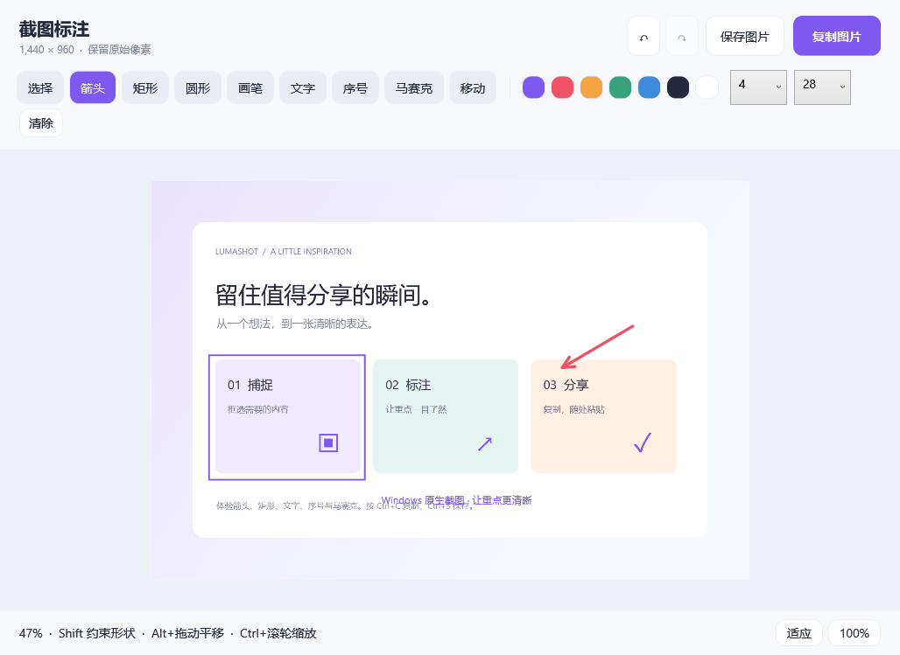
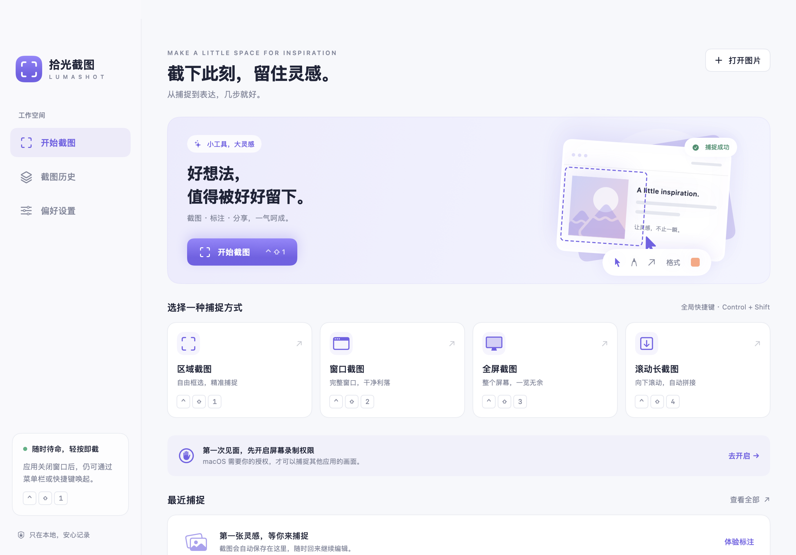
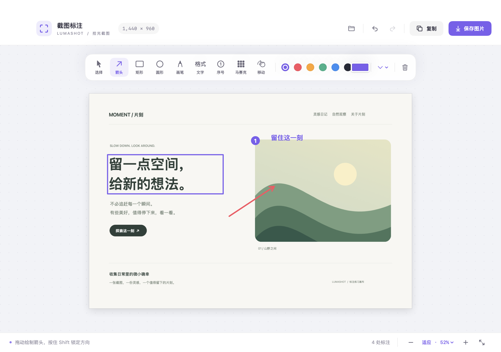

# 拾光截图 · LumaShot

原生桌面截图与标注工具。macOS 版适用于 macOS 14 及以上，使用 SwiftUI、AppKit 和 ScreenCaptureKit。

**Windows 版：**[下载 Windows v0.1.0](https://github.com/BenjaminXu24/LumaShot/releases/tag/windows-v0.1.0)，包含区域/窗口/全屏/滚动长截图、标注、复制与保存，提供 x64/ARM64 安装包和免安装包。详见 [Windows 使用与开发说明](Windows/README.md)。以下说明针对 macOS 版。

在另一台 Windows 电脑从源码构建，请按 [Windows 开发与验证](Windows/README.md#开发与验证) 准备 Git、PowerShell 7.2+、.NET 10 SDK，以及打包所需的 Inno Setup 6.3+；仓库已提供环境检查、编译、自动测试和 x64/ARM64 打包脚本。

<details>
<summary>查看 Windows 版界面</summary>




</details>

[English](README.md) · [下载 v0.1.0](https://github.com/BenjaminXu24/LumaShot/releases/tag/v0.1.0) · [反馈问题](https://github.com/BenjaminXu24/LumaShot/issues)



## 下载

从 [GitHub Releases](https://github.com/BenjaminXu24/LumaShot/releases) 下载 **[LumaShot-v0.1.0-macOS-universal-notarized.zip](https://github.com/BenjaminXu24/LumaShot/releases/download/v0.1.0/LumaShot-v0.1.0-macOS-universal-notarized.zip)**，解压后将 `LumaShot.app` 拖入「应用程序」。通用包同时支持 Intel 和 Apple Silicon。

公证版附带 [SHA256SUMS-notarized.txt](https://github.com/BenjaminXu24/LumaShot/releases/download/v0.1.0/SHA256SUMS-notarized.txt)，将它和安装包放在同一目录，运行 `shasum -a 256 -c SHA256SUMS-notarized.txt` 即可校验。

这是早期可用版本，当前界面为简体中文。第三方自动滚动、物理多显示器组合仍需更多实际验证；动画、虚拟列表、重复图案或重叠不足可能影响拼接。历史记录保存原图，标注会话不持久化。

## 运行

双击解压得到的 `LumaShot.app`，也可以将应用拖进「应用程序」文件夹。源码构建的应用位于 `build/LumaShot.app`。

首次截图时，在「系统设置 → 隐私与安全性 → 屏幕与系统音频录制」允许「拾光截图 / LumaShot」。如系统提示重新打开应用，请退出再启动。自动滚动长截图还需要「辅助功能」权限；不授权辅助功能也可以手动滚动拼接。

推荐下载的 `*-notarized.zip` 已完成 **Developer ID 正式签名、Apple 公证及票据装订**，双架构均通过 Apple 检查，并已通过本机 Gatekeeper 验证。

原始 `LumaShot-v0.1.0-macOS-universal.zip` 及其 `SHA256SUMS.txt` 保留不变；该旧包使用临时签名且未公证，安装时请选择名称带 `notarized` 的版本。本地及 CI 构建默认仍使用临时签名。

## 使用

| 方式 | 全局快捷键 | 操作 |
| --- | --- | --- |
| 区域截图 | Control + Shift + 1 | 拖动框选，松开鼠标截图 |
| 窗口截图 | Control + Shift + 2 | 移动鼠标高亮窗口，点击捕捉 |
| 全屏截图 | Control + Shift + 3 | 捕捉鼠标所在的显示器 |
| 滚动长截图 | Control + Shift + 4 | 框选内容区，自动或手动滚动拼接 |

截图会进入标注编辑器。区域/窗口选择时按 Esc 或右键取消。关闭主窗口后应用仍在菜单栏运行，使用菜单栏「退出」或 Command + Q 完全退出。

长截图建议只选择滚动内容，避开不随内容移动的侧栏、播放器和工具栏。自动滚动遇到底部会暂停，点击「完成」进入标注；也可以随时暂停、手动滚动约半屏，然后「添加当前屏」。相邻画面需要保留重叠部分；匹配失败会保留已拼接内容并提示回滚，避免丢失当前结果。支持常见固定页眉/页脚的去重，上限 50,000 像素，并根据图像宽度限制在约 8,000 万总像素以内。动画、视频、虚拟列表、内容变化或整片重复图案可能无法可靠拼接。

## 标注



支持选择/移动、箭头、矩形、椭圆、画笔、文字、序号、马赛克、画布移动；可选择颜色、线宽，撤销、重做和清除。

- Command + C：复制完整标注图到剪贴板。
- Command + S：保存 PNG 或 JPEG；默认建议下载文件夹，可自由更改。
- Command + Z / Command + Shift + Z：撤销 / 重做。
- Command + 0 / Command + 1：适应窗口 / 100%。
- V / A / R / O / P / T / N / M / H：快速切换工具。T 是文字工具；Command + T 是翻译识别结果。
- 按住 Shift 绘制正方形、正圆或锁定箭头角度；Option + 拖动可平移。
- 选中标注后 Delete 删除。

标注按原始图片像素导出，保留 Retina 分辨率。马赛克会直接改变导出图片的像素。

「体验标注」提供本地生成的练习图，不需要屏幕权限。「打开图片」可编辑现有 PNG、JPEG、HEIC、TIFF、WebP，也可以将图片文件通过 Finder 的「打开方式」交给本应用。

## 翻译

识别出文字后，可以在结果里一键翻译。语言为中文、English 和 Filipino。原文可以自动检测，也可以手动指定；目标语言从这三种里选择。快捷键是 Command + T。可以分别复制原文、译文，或两者一起复制。

- **DeepSeek 在线**（默认）：调用官方 Chat Completions 接口 `https://api.deepseek.com`，模型为 `deepseek-flash`。API Key 由你自己填写，只保存在 macOS 钥匙串，不会写入源码、文档或日志。第一次在线翻译前会询问是否允许发送文字。
- **Apple 离线**（可选，macOS 15 及以上）：使用系统 Translation 框架，在本机翻译，不需要联网同意。如果系统没有对应语言（部分系统暂不支持 Filipino），可以改用 DeepSeek，或在「系统设置 → 通用 → 语言与地区 → 翻译语言」中下载语言。

默认不联网；仅在用户点击翻译且选择在线引擎时发送识别出的文字（不含图片）。不会缓存译文。Windows 版这次不包含翻译。

## 本地数据

原始截图保存在 `~/Library/Application Support/LumaShot/Captures/`，自动保留最近 100 张。历史记录可按类型筛选、搜索文件名、重新编辑、复制、另存或删除。标注结果需要复制或另存；历史保存的是原始截图，不保存标注会话。不需要账号。默认不联网；仅在用户点击翻译且选择在线引擎时发送识别出的文字（不含图片）。不会缓存译文。

偏好设置可开启自动复制、提示音、截图延时和登录启动，设置翻译引擎、语言和 DeepSeek API Key，并查看权限与快捷键注册冲突。登录启动需从完整 `.app` 运行。

## 开发

要求 Xcode 15+ / Swift 5.9+；推荐当前 Xcode。

```sh
git clone https://github.com/BenjaminXu24/LumaShot.git
cd LumaShot
swift build
swift test
./scripts/build.sh
./scripts/build.sh --universal
open build/LumaShot.app
```

`--universal` 构建同时支持 Apple Silicon 与 Intel 的应用；默认构建当前 Mac 架构。Swift Package 可直接由 Xcode 打开。

运行 `./scripts/package-release.sh` 可以生成带版本号的通用 ZIP 和 SHA-256 文件，产物位于 `build/releases/`。打包脚本会检查双架构、签名、许可证和压缩包完整性。

正式 Developer ID 签名、提交 Apple 公证、装订票据和 Gatekeeper 验证请参阅[公证流程说明](docs/NOTARIZATION.md)。需要你自己的 Developer ID Application 证书及本机钥匙串认证配置。

生成无需屏幕录制权限的界面预览：

```sh
build/LumaShot.app/Contents/MacOS/LumaShot --render-previews build/previews
```

17 项测试已通过，覆盖长截图像素顺序/固定页眉页脚/重复画面/不相关画面/高度上限、本地图像保存与保留策略、标注像素和渲染方向等。也已通过实际 ScreenCaptureKit 全屏捕捉验证（2880 × 1800，不保存测试屏幕像素），并验证编辑器原生复制/撤销菜单响应。物理多显示器和第三方页面自动滚动尚需在相应权限及设备下验证。

可选真实截图接口检查（不会主动请求权限，也不会保存捕获画面）：

```sh
swiftc -parse-as-library -swift-version 5 -o build/CaptureSmoke Sources/LumaShot/Models.swift Sources/LumaShot/Capture/*.swift scripts/CaptureSmoke.swift
build/CaptureSmoke
```

## 结构

- `Sources/LumaShot/Capture/`：ScreenCaptureKit 捕捉、选择遮罩、滚动控制和图像拼接。
- `Sources/LumaShot/Editor/`：标注模型、原始像素渲染器、画布及编辑窗口。
- `Sources/LumaShot/Services/`：Carbon 全局快捷键、本地历史、图像导出、文字识别，以及 Mac 翻译（钥匙串、DeepSeek、Apple 翻译）。
- `Sources/LumaShot/`：应用入口、主界面、历史与偏好设置。
- `Resources/Info.plist`：应用包配置与权限说明。
- `scripts/build.sh`：生成图标、构建应用，默认临时签名，可选 Developer ID 签名。
- `scripts/notarize.sh`：正式签名、提交 Apple 公证、装订票据及验证。

捕捉接口参考 [Apple ScreenCaptureKit 文档](https://developer.apple.com/documentation/screencapturekit/scscreenshotmanager)。

## 参与贡献

欢迎提交问题、滚动兼容性反馈、无障碍改进和 Pull Request。请阅读 [贡献指南](CONTRIBUTING.md) 和 [更新记录](CHANGELOG.md)。默认不联网；仅在用户点击翻译且选择在线引擎时发送识别出的文字（不含图片）。无遥测。

## 许可证

[MIT](LICENSE) · Copyright (c) 2026 BenjaminXu24。
